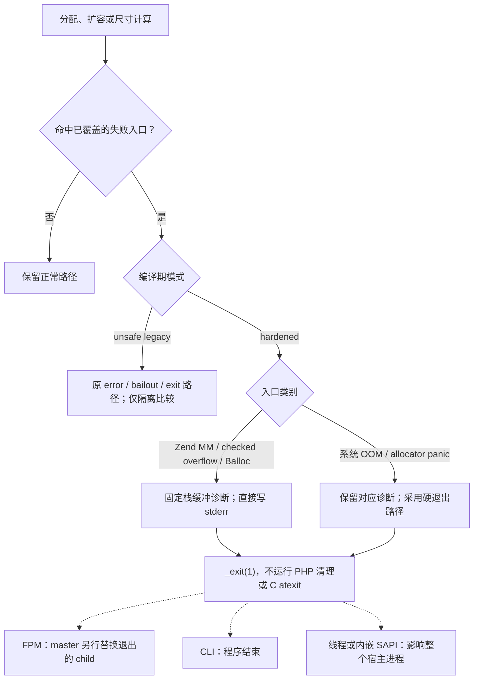
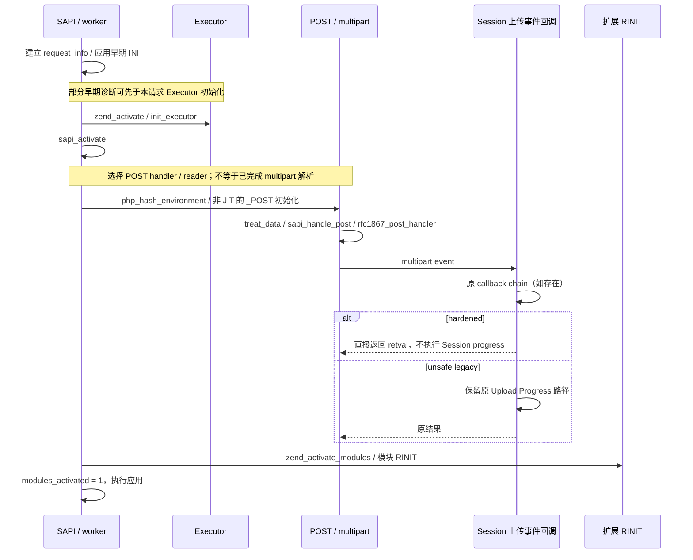
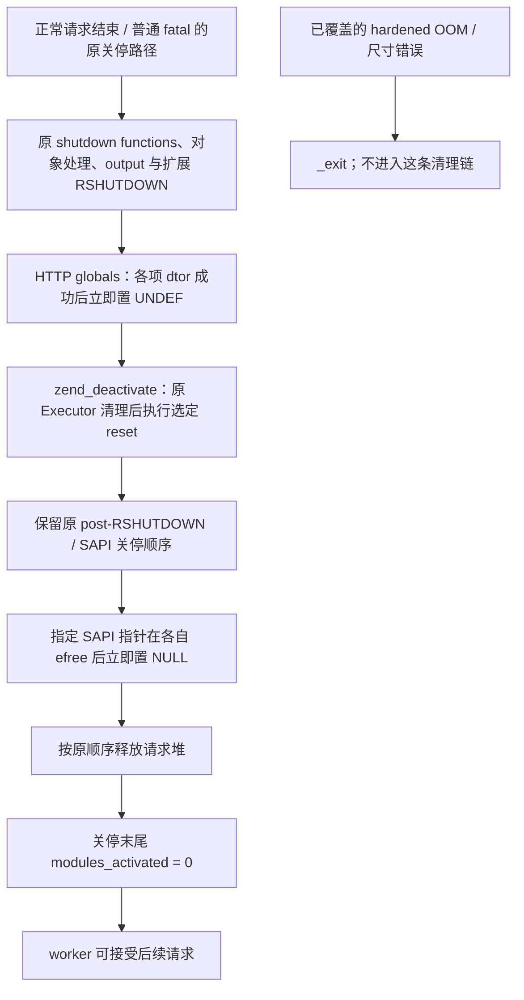
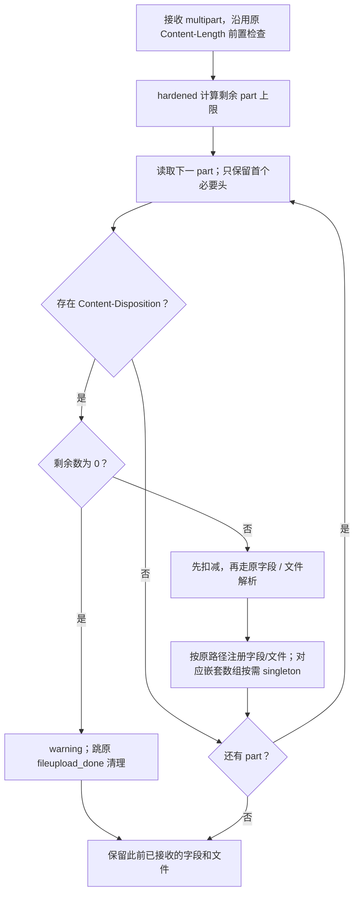

# PHP 7.0 安全回移植：设计与流程

日期：2026-10-24。实现快照：`7cd812eb6e074a723483c727fac49aca8816befa`。
基线：PHP 7.0.33 `bf574c2b67a1f786e36cf679f41b758b973a82c4`。
本文解释机制；逐文件状态见[文件清单](php70-security-change-inventory.md)，选择理由见[ADR](php70-security-adr.md)。
文中 HEAD、未提交文件和 CI 状态均指上述实现快照及本批提交前的验证时点，后续结果以对应提交的 CI 为准。

## 1. 从目标和不变量出发

只适配 CVE-2026-109618 / CVE-2026-109619 的官方 EOL 最小缓解，处理必要的 PHP 7.0 表示差异，
并验证本次改动没有引入回归。不做 PHP 7 全面加固、不顺手修原有无关 bug、不整体重写请求生命周期。

| 目标风险 | 需要守住的不变量 | 本分支的实现 |
| --- | --- | --- |
| 分配失败或尺寸溢出打断构造，旧 bailout 仍进入清理 | 不让已覆盖的危险中间状态继续运行错误处理、析构或退出回调 | allocator/算术/Hash/字符串/VM/dtoa 对应入口在 hardened 下 fail-stop |
| 请求堆结束后，worker 槽位仍引用旧请求数据 | 在已覆盖的释放/清理点解除引用，减少下一请求早期消费 | 选定 Executor、链表端点、SAPI 指针、HTTP globals 和模块标志重置 |
| Session progress 在模块 RINIT 前执行 | 不能把已知早期 Session 消费链留给请求后期 INI 修复 | hardened 无条件跳过 Session Upload Progress |
| multipart 和输入树放大内存压力 | 限制本次补丁所覆盖的保留头、part 数和初始数组容量 | 首个必要头、part 限额、singleton 输入数组及其对齐适配 |

四层机制互补。输入限额不能代替 OOM 硬退出；禁用 progress 不能证明全部 early callback 安全；
选定字段 reset 也不是“所有扩展状态已完整恢复”。

直接参考是 [PHP 7.4 官方最小缓解 712e60f9](https://github.com/php/php-src/commit/712e60f9edfd03f0960fc4fc3c2c375f42b90aa2)。
7.1 社区实现只作适配参考，不能把它当已合并的官方 PHP 7.0 修复，更不能复制新版本 VM/HashTable 布局。

## 2. 编译期模式与代码组织

默认 `PHP70_SECURITY_HARDENED=1`。显式 `--disable-php70-security` 生成 unsafe legacy 对照；
`php70_security_is_hardened()` 返回编译期常量，不访问 INI、不为模式判断分配内存。
切换模式必须 clean 重建，外部扩展也使用同模式头文件。legacy 不作为生产回退方案。

| 组织方式 | 适用位置 | 保留的约束 |
| --- | --- | --- |
| A：同文件新增小 helper | reporter、Executor reset、part 限额、hardened substring、singleton API | 原位置分支；不引入动态 Hook 或运行期策略切换 |
| B：原位 guard/重置 | VM 分配前、SAPI efree 后、HTTP global dtor 后、Session callback | 不移动对象所有权、析构顺序和 cleanup label |
| C：固定表示/工具不变量 | HashTable 对齐、ZSTR_MAX_LEN 定义、PHP 7.0 生成器正则 | 不能按请求切换；两种比较构建都保持这些必要不变量 |

这是可控的比较变体，不意味着 legacy 与未修改基线逐字或逐二进制相同。

## 3. OOM 与尺寸错误流程

图中虚线是进程退出的外部后果，不是 PHP 在 `_exit()` 后继续执行判断。
FPM master 的替换行为是受测 FPM 场景，不能泛化到其他 SAPI。
原 Debug panic 可能先发送 SIGSEGV；此旧调试行为保留，因此不能断言所有 panic 最终都返回退出码 1。

`zend_mm_safe_error_hardened()` 使用 1024 字节栈缓冲和 libc 格式化，按执行/编译状态取得文件及行号，
写 stderr 后退出。它不调用 Zend allocator、INI 或常规 `zend_error()` 链。
这不构成 async-signal-safe、任意堆破坏下必然安全的保证，也不意味着诊断经过 PHP error_log/display_errors。

覆盖入口分布于 `zend_alloc.c`、`zend_multiply.h`、`zend_hash.c`、`zend_strtod.c`、`zend_vm_def.h`。
系统 malloc/realloc 失败和 panic 的部分路径直接硬退出，不要求都经过同一个格式化函数。
第三方 custom allocator、原始 malloc 使用者和旧扩展内联 guard 有各自边界。

### 普通 fatal 保持原行为

本次不将所有 `zend_error_noreturn()` 全局替换为 `_exit()`。普通 fatal、parse error、timeout 与 OOM 不是同一类错误。
受测 `E_USER_ERROR` 在原始及 hardened PHP 7.0 中都执行注册的 shutdown function，且该测试场景原本不执行对象析构函数。
因此“普通 fatal 保留关停语义”不能被简化为“所有 fatal 都执行全部析构器”。

`USE_ZEND_ALLOC=0` 关闭 Zend MM 的有限 memory_limit 约束。其功能/ASan 检查必须与默认 Zend MM 的 OOM 检查分开，
不能用 MM-off 下跳过 memory_limit 测试冒充 OOM 验证通过。

## 4. 请求时序与 Session 早期消费

以下为非 `APACHE_HOOKS` 的普通请求路径；`variables_order` 含 `P` 等正常 POST 配置前提成立。
旧 hooks 路径和其他 SAPI 不能不加区分地套用此图。

关键不是把 progress 的默认 INI 改成 Off，而是 hardened 回调在原 chain 之后直接返回。
因此即使配置显示 `session.upload_progress.enabled=1`，也不能重新开启这段早期逻辑。
普通 Session 和文件上传保留；原第三方回调链仍存在，本次并未宣称所有上传回调安全。

源码入口：`main/main.c::php_request_startup`、`main/SAPI.c::sapi_activate/sapi_handle_post`、
`main/php_variables.c::php_hash_environment/php_auto_globals_create_post`、
`ext/session/session.c::php_session_rfc1867_callback`。

## 5. 关停时的指定引用重置

这是正常到达各步骤时的顺序模型，不是事务回滚保证。旧 `zend_try` 捕获不能恢复所有中间状态；
若单项 dtor 或清理被中断，该点后面的重置未必执行。`zend_llist_destroy()` 的端点重置发生在它自己的原销毁点，
不应为了画图而将所有链表统一搬到某个新关停阶段。

| 位置 | 实际增加的重置 | 没有承诺的内容 |
| --- | --- | --- |
| Executor 清理末尾 | error/exception handler、三个对应 stack、error handling、exception、object store buckets/top | 未将全部 EG 字段清零；不补未经证明的 free_list_head 改动 |
| llist 节点销毁后 | head/tail 置 NULL，沿用 count=0 | 不重排节点析构或改变通用链表契约 |
| SAPI 各释放点后 | auth_user/password/digest、content_type_dup、current_user | 不清理第三方 SAPI 全部自有状态 |
| 核心请求关停 | HTTP globals 逐项 UNDEF；末尾模块激活标志归零 | 不替代全部扩展的 RSHUTDOWN/RINIT |

普通 fatal 后测试同 PID 复用；OOM 后测试不同 PID 并继续服务。这两种断言是有意区分的，并不矛盾。
FPM 启动失败本来就会退出 child，本次不能把这一既有行为记作新补丁创造的收益。

## 6. Multipart 限制与输入数组

上图聚焦 hardened 分支；legacy 不运行新 part 校验。无 Content-Disposition 的 part 不消耗这里的计数，
因此不能把它描述成任意原始 boundary 片段数量的通用上限。

- `max_multipart_body_parts >= 0`：直接使用该值，0 拒绝首个被计数 part。
- 任意负配置值按当前实现走派生分支；文档化默认值是 -1。
- 派生值为 `max_input_vars + max(max_file_uploads, 0)`，使用 `zend_long` 并饱和到 `ZEND_LONG_MAX`。
- 计数包含空 filename 控件；判断零后再减，避免预减越界。
- 只保留首个 Content-Disposition / Content-Type；未知和重复头不进入保留列表。
- hardened `substring_conf_hardened(size_t)` 与旧 `substring_conf(int)` 分开，保留旧 helper 和调用契约。

这里没有新增对 decoded body 的实际总字节限额。大字段、大头或不可信长度仍可能引起 OOM 和 worker 退出；
part 数与 retained header 策略不能被描述成完整上传字节限流。

### Singleton 的 PHP 7.0 必要适配

`_array_init_singleton()` 先调用 7.0 原初始化，再将尚未实际分配 bucket 的表容量设为 1。
适配范围是顶层 GET/POST/COOKIE 和指定嵌套注册路径；顶层 `$_FILES` 仍用原 `array_init()`。
顶层 POST 的初始化先于 RFC1867 handler，不是逐 part 重新初始化。
PHP 7.0 mixed 表原 mask 为 `-capacity`：容量 1 时只有一个 uint32 索引前缀，可能令 Bucket 地址偏移 4 字节。
本分支在 mixed 初始化和 packed→hash 都至少保留两个索引槽，维持真实 Bucket 对齐，逻辑容量仍为 1。
普通容量的表示、公共结构体布局均不整体迁移成 7.4。

对齐按编译器实际要求验证，不要求地址整除 `sizeof(Bucket)`。
新 API、输入调用点、两条 HashTable 布局路径和增长/COW 测试必须作为一个适配单元审查。

## 7. VM 生成与扩展边界

三个 VM 模板分配点的 guard 经 7.0 生成器变成 `zend_vm_execute.h` 中 27 个专用 guard。
本次 `/me`→`/m` 是生成这些 handler 所需的工具修正。CI 用本分支 PHP 7.0 重跑生成器，
逐字比较 execute 和 opcodes 两个头；opcodes 头相对基线没有改动，因此不列入改动清单。

公共布局头和 API 标识保持不变，但新增 helper 是新增符号；“旧扩展能加载”不证明旧 inline guard 已更换。
已有旧扩展实证仍可走旧 bailout。部署扩展需匹配 hardened 头文件重编，不能通过把全部普通 fatal 也硬退出弥补它。

## 8. 验证设计、真实结果与未验证范围

| 层次 | 当前做法 | 能证明 / 不能证明 |
| --- | --- | --- |
| 安全 PHPT | HEAD 12 条；本地另 2 条；普通 fatal 与 OOM 分开 | 验证对应输出和业务行为，不穷举所有 allocator 或生命周期 |
| 原生 probe | 13 项，实际 Bucket 对齐、容量、九类失败入口 | 验证选定内部路径；dtoa 定向失败仍未注入 |
| FPM | 11 项，正常同 PID、fatal 复用、早期诊断、OOM 换 PID、Session/上传 | 验证受测 Unix socket worker，非全部 SAPI/回调 |
| ASan / allocator | 默认 Zend MM；另做 MM-off 功能检查 | 无已执行路径的 sanitizer 报告，不等于无所有 UAF；未启用泄漏检测 |
| cgroup | 64/96/128 MiB，PHP limit 与 kernel OOM 分开 | 验证真实限额、退出原因和恢复；SIGKILL 不验证 reporter |
| 完整 PHPT 历史对照 | baseline 35 fail，hardened 44 fail，9 个新增差异保留并解释 | 全量不是全绿；不靠删除旧期望掩盖兼容变化 |

当前自动矩阵共 10 组：Debian 12 amd64 Debug/Release/ASan/legacy；Ubuntu 22.04 和 24.04 amd64 各 Debug/Release；
Debian 12 arm64 Debug/Release。工具链无预装 PHP，测试均从 checkout 编译 PHP 7.0.33，并强制版本断言。
每次安全分支 push 只运行一套；job 上限 20 分钟，阶段为 5/10/3/2 分钟，排队不计入执行预算。
只有 Debian amd64 Debug job 额外执行 cgroup 组。push CI 不运行完整 PHP 功能回归，也不部署二进制。

已核实 [7cd812 的原生 run 39941839719](https://github.com/fangfengxiang/php-src/actions/runs/39941839719) 成功，
北京时间 2026-10-23 18:49:50 至 18:54:19，4 分 29 秒。该 HEAD 的 10 组均通过，但没有包含本地两条未提交 PHPT。
它们与邻近 multipart 用例另在 PHP 7.0.33 arm64 本地跑 9/9，通过；原始基线不满足两条新限制预期，详见
[报告复核](security/report-review-2026-10-24.md)。

旧 [verification.md](security/verification.md) 的 11 PHPT/9 FPM 和 x86_64 未测等文字是早期快照，
不能覆盖后来原生 CI 的时点；[ci-first-hosted-run.json](security/results/ci-first-hosted-run.json) 是 e4f3878 的首轮，
不是这里 7cd812 的最终成功记录。不同环境、编译模式和代码版本不能合并成一轮“全绿”。

仍未覆盖 Windows、ZTS、32 位、mod_php、任意第三方扩展/自定义 allocator、dtoa 定向注入和全部 timeout/中断路径。
Docker 发行版是用户态差异，不是各发行版内核矩阵；Rosetta 模拟与 GitHub 原生架构结果也要分开。
这些是验证边界，不自动成为新增运行时改造任务。后续动作仍须符合本次漏洞目标与实际部署需要。
